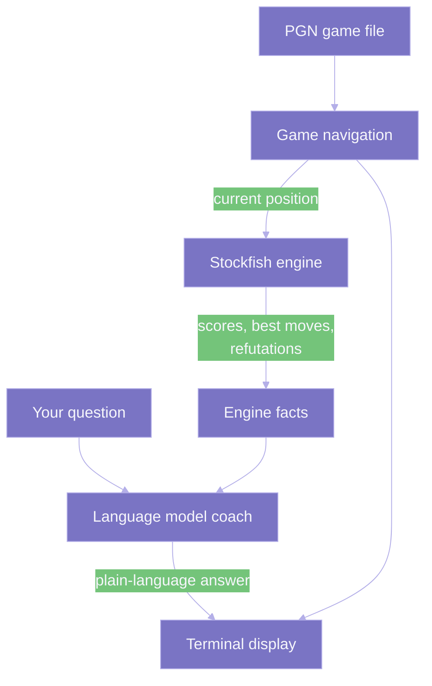

# Dupont

[](https://jconnors23.github.io/Dupont/)

> A natural-language Stockfish adapter: ask about a chess game in plain English and get answers grounded in the engine, not hallucinated. Local prototype, individual use.

**Live documentation site: [jconnors23.github.io/Dupont](https://jconnors23.github.io/Dupont/)**

Dupont is a **natural-language adapter for Stockfish**. It reads a saved chess game (a PGN file) and lets you ask about it in plain English — "why was that a mistake?", "what was my opponent threatening?" — with every answer grounded in the engine's actual calculation rather than guessed at.

It exists to fix a specific failure: uploading a PGN straight into a general chatbot like ChatGPT or Gemini and asking about the game reliably produces **hallucinated game states** — the model misremembers where pieces are, invents moves, and gives confident but wrong evaluations. Dupont puts a real chess engine in the loop so that cannot happen.

The design keeps two jobs apart. **Stockfish** does the exact calculation (best moves, position scores, refutations). A **local language model** (through Ollama) only puts those facts into words; it is told to explain what the engine found and never to invent moves or evaluations of its own. The language model is a translator for the engine, not a chess player in its own right.

> **Status:** early prototype for personal, single-machine use. There is no packaged release and no hosted version; the docs are working notes rather than a public user guide.

## How It Works



## Quickstart

Install Stockfish and the Python packages, then run the included sample game. The one-time setup:

```bash
brew install stockfish
```

```bash
python -m venv .venv
```

```bash
source .venv/bin/activate
```

```bash
pip install -r requirements.txt
```

Optionally start a local model for written explanations (skip it and the coach prints engine facts instead):

```bash
ollama pull llama3.1:8b
```

```bash
ollama serve
```

Run a game:

```bash
python -m dupont.cli tests/sample_game.pgn
```

Run the tests (uses `pytest` and `hypothesis`):

```bash
pytest -v
# or: python run_tests.py
```

This project targets Python 3.11+ (developed on 3.13). Full setup details are in the documentation linked below.

## Project Layout

```text
dupont/                        # workspace root
├── dupont/                    # the application package
│   ├── __init__.py
│   ├── cli.py                 # Interactive terminal loop: navigation, commands, questions
│   ├── config.py              # Reads engine path and model settings from .env
│   ├── engine.py              # Stockfish wrapper: analysis and move refutation
│   ├── game_state.py          # PGN parsing and move navigation
│   ├── pgn_cleaner.py         # Strips PGN headers so a game starts at move 1
│   └── coach.py               # LLM client: turns engine facts into plain-language coaching
├── tests/
│   ├── test_chess_coach.py    # Test suite (pytest, unittest.mock, Hypothesis)
│   └── sample_game.pgn        # The 1858 Opera Game
├── games/                     # Sample PGNs for review
├── docs/                      # Documentation site source (MkDocs)
├── run_tests.py               # Runs the test suite without extra flags
├── pytest.ini                 # Test configuration
├── requirements.txt
└── .env.example               # Copy to .env and adjust paths
```

## Documentation

| Page | What it covers |
| :--- | :--- |
| [Overview](./docs/index.md) | What Dupont is and what it can do today |
| [How It Works](./docs/architecture.md) | The parts, how they talk, and why the coach cannot make up chess |
| [Dual-Engine Design](./docs/architecture/design.md) | Planned Stockfish + Lc0 layer and the target local hardware |
| [Design Rationale](./docs/design-rationale.md) | Why the project is built this way — a running decision log |
| [Local Setup](./docs/how-to-run.md) | Setting it up on your own machine |
| [Commands Reference](./docs/using-the-coach.md) | The interactive commands and output format |
| [Status & Roadmap](./docs/conclusions.md) | Prototype status, constraints, and what's planned |
| [Glossary](./docs/glossary.md) | Key terms, both chess and technical |

The full set is published as a site at **[jconnors23.github.io/Dupont](https://jconnors23.github.io/Dupont/)**. To browse it locally instead, run `mkdocs serve` and open the address it prints.

### Publishing The Site

The site deploys automatically to GitHub Pages on every push to `main`, via the workflow in `.github/workflows/docs.yml`. For the first deploy to work, enable Pages once in the repository: go to **Settings → Pages** and set the source to **GitHub Actions**. After that, each push rebuilds and republishes the site at the link above.
