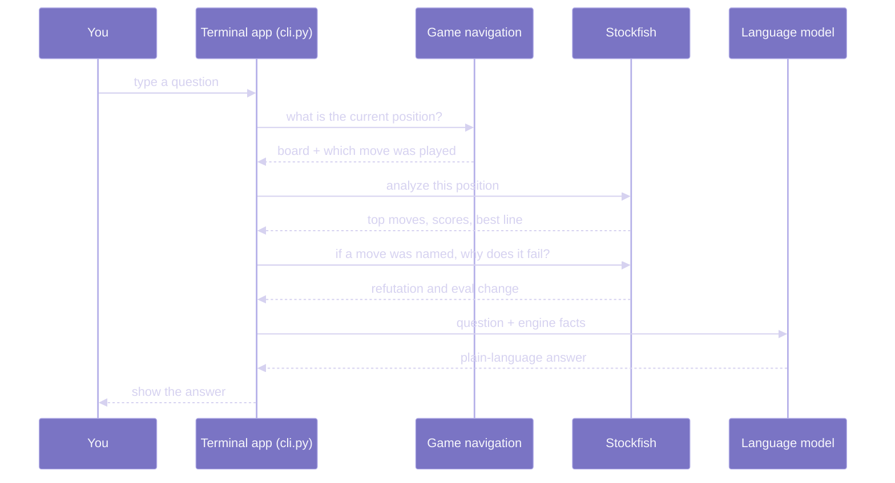
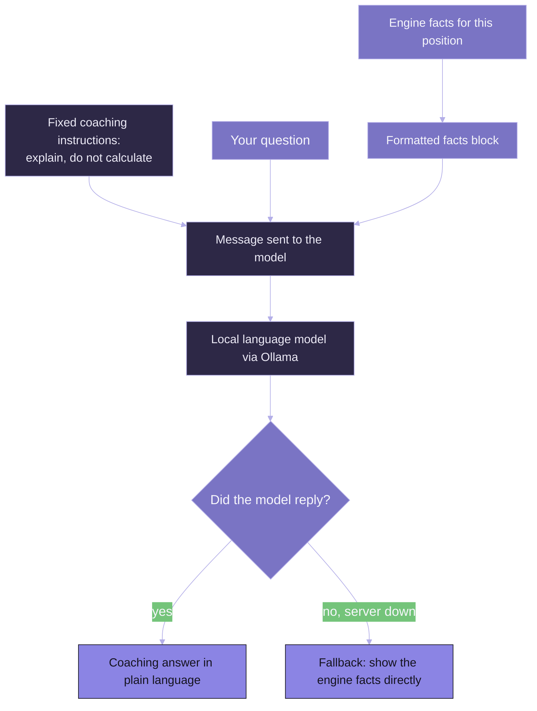
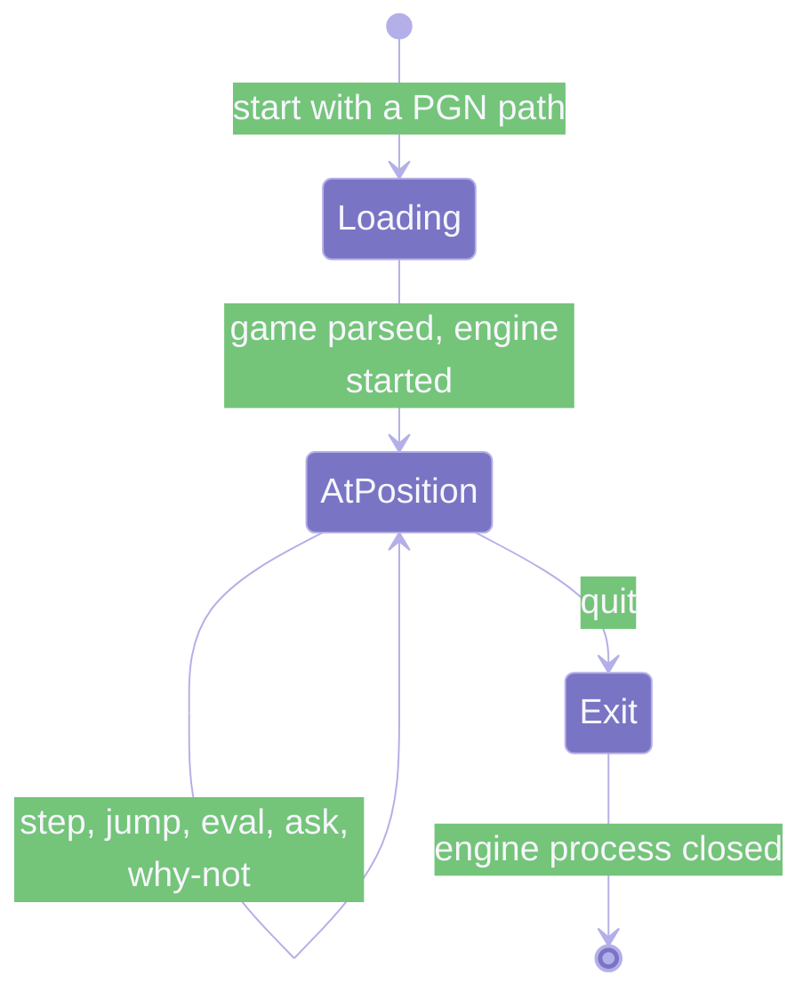

---
hide:
  - toc
---

# How It Works

Dupont is a natural-language adapter for Stockfish: the engine does the chess, and a language model only translates its output into words. The program is a single interactive terminal session built from four parts. Each part has one job, and they are kept apart on purpose so the exact chess calculation never gets mixed up with the plain-language translating.

## The Four Parts

| Part | File | What it does |
| :--- | :--- | :--- |
| Game navigation | `core/game_state.py` | Reads the PGN, splits it into individual half-moves, and tracks where you are in the game. |
| Chess engine | `core/engine.py` | Wraps Stockfish. Scores positions, lists top moves, and works out why a move fails. |
| Coach | `agent/coach.py` | Sends the engine's facts and your question to the language model and returns its reply. |
| Terminal app | `cli.py` | The command loop you type into. Draws the board, reads your commands, and calls the other three. |
| Settings | `core/config.py` | Reads the engine path and model settings from your environment or a `.env` file. |

A half-move (one side playing once) is called a *ply*. A full move number like "14" covers White's 14th move and Black's reply, so the program tracks position by ply and lets you ask for either side of a move number.

## How A Question Becomes An Answer

When you ask the coach something, the position is analyzed first and the engine's results are handed to the language model. The model never calculates chess itself; it only rewrites the engine's findings as advice.

If the question names a specific move, the app also asks the engine to refute that exact move. If it does not, but you are sitting on a move that was played in the game, the app refutes the played move so questions like "why is this a mistake?" have something concrete to explain.

## What The Engine Produces

The engine wrapper (`core/engine.py`) exposes two things the rest of the program relies on.

**Position analysis** returns the top candidate moves, each with a score from White's point of view, and the line of play the engine expects to follow. The wrapper can return several lines; the `/eval` command asks for the top two. Scores are shown in pawns (for example `+1.25` means White is ahead by a little over a pawn) or as a forced mate (for example `#+3` means mate in three for the side to move).

**Move refutation** takes one candidate move, plays it on a copy of the board, and asks the engine what the best reply is. It compares the position's value before and after, then labels the move. The labels come straight from how much the move loses, measured in centipawns (hundredths of a pawn):

| Label | How much the move loses (from the mover's side) |
| :--- | :--- |
| Best Move | Matches the engine's top choice, or loses nothing. |
| Good Move | Loses less than 0.30 of a pawn. |
| Inaccuracy | Loses 0.30 to 0.80 of a pawn. |
| Mistake | Loses 0.80 to 2.00 pawns. |
| Blunder | Loses 2.00 pawns or more, or walks into a forced mate. |

These thresholds are fixed in the engine wrapper, so the same move always gets the same label.

## Why The Coach Cannot Make Up Chess

The coach is given a strict instruction set and a block of engine facts, and nothing else to work from. The facts block names the position, whose turn it is, the move played, the engine's best move and score, the move being asked about and its label, and the opponent's punishing reply when there is one.

The instructions tell the model to translate the engine's lines into human ideas (naming tactics like forks, pins, and back-rank weaknesses, or positional points like king safety and piece activity) and to never invent moves or scores. Because the model only sees the engine's facts, it has nothing to hallucinate from.

If the language model server is unreachable, the coach does not fail. It falls back to printing the engine's facts in a readable form, so you still get the best move, the score, and the refutation even with no model running.

## Where State Lives

The game is loaded once into memory as a list of plies, and a single index marks the current position. Stepping forward or back, or jumping to a move number, just moves that index. The engine runs as a separate Stockfish process that the app starts on launch and shuts down on exit. The coach keeps a running conversation history so follow-up questions have context, and you can clear that history at any time.

For the exact commands that drive these transitions, see the [Commands Reference](./using-the-coach.md).
