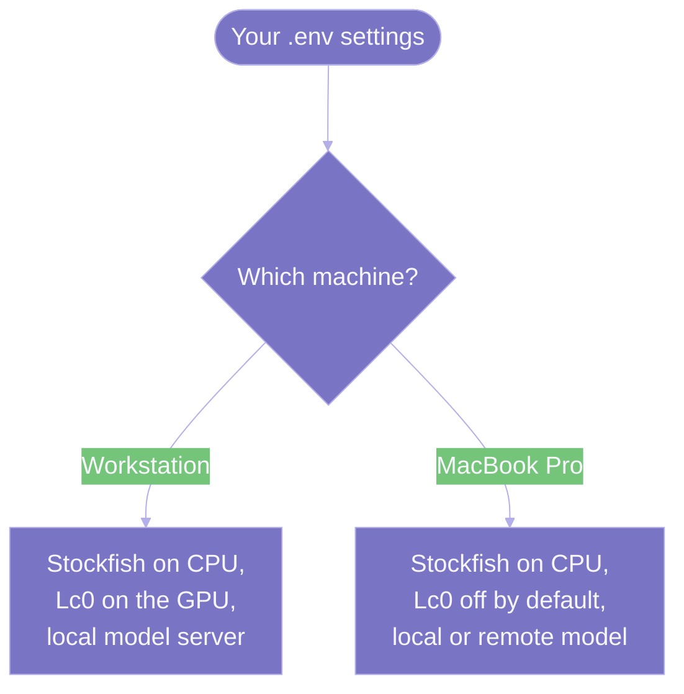

---
hide:
  - toc
icon: material/chess-queen
---

# Architecture Design: Dual-Engine Evaluation

This page is the design specification for the evaluation layer — the engine side of the natural-language Stockfish adapter. It describes the target architecture, where two chess engines (not just one) feed the language model that puts their output into words, and the local hardware profiles the product is built to run on.

A note on status before anything else: the current code uses **Stockfish only**. The second engine (Leela Chess Zero) and the hardware-profile switching described here are the planned design, not shipped behavior. Each section flags what is implemented today versus what is planned. For how the current Stockfish-only code actually works, see [How It Works](../architecture.md).

## Why Two Engines

The two engines are good at different things, and the split is the whole point of the design.

| Engine | Strongest at | Weaker at |
| :--- | :--- | :--- |
| Stockfish | Concrete tactics, forced lines, exact material and mate counting, finding the refutation to a bad move. | Quiet positions where the best move is a matter of long-term judgement rather than a forcing sequence. |
| Leela Chess Zero (Lc0) | Long-term positional judgement: compensation for sacrificed material, piece activity, pawn-structure quality, where to steer a quiet game. | Sharp, deep tactical sequences that reward brute-force search. |

The difference comes from how each engine works. Stockfish searches many moves deep and scores positions with a fast, mostly hand-tuned evaluation. Leela Chess Zero (Lc0) is a neural-network engine that learned chess from self-play — the AlphaZero-style approach — so it leans on pattern judgement rather than brute-force search. That is why Stockfish answers "what is forced here and how much does this move lose," while Lc0 answers "who stands better in the long run and why, even when nothing is forced." The coach gets both kinds of fact and can explain both kinds of position. (For the engine's background in one place, see the [Glossary](../glossary.md).)

## How The Layer Is Arranged

Both engines sit behind one evaluation layer. The coach receives a single combined block of facts and does not need to know which engine produced any given number.

```mermaid
%%{init: {'theme':'base','themeVariables':{'fontSize':'20px','primaryColor':'#7a74c4','primaryTextColor':'#f6f6fb','primaryBorderColor':'#b4afe8','lineColor':'#b4afe8'},'flowchart':{'nodeSpacing':50,'rankSpacing':60}}}%%
flowchart LR
    POS([Current position]) --> SF[Stockfish:<br/>tactics and scores]
    POS --> LC[Lc0: positional<br/>judgement &#40;planned&#41;]
    SF --> COMB[One set of<br/>engine facts]
    LC --> COMB
    COMB --> COACH[Model puts it<br/>into plain English]
    COACH --> OUT([You read it])
```

Today only the Stockfish path exists; the Lc0 path is planned. When Lc0 is absent — on hardware without a usable neural backend, or in the current code — the facts are Stockfish-only and the coach works exactly as it does now.

## What Each Engine Contributes To The Facts

The coach's fact block is designed to carry both engines' output, clearly labelled by source so the coach can attribute each point.

| Fact | Source | Status |
| :--- | :--- | :--- |
| Best move and top candidate lines | Stockfish | Implemented |
| Centipawn score and mate counts | Stockfish | Implemented |
| Move classification (Blunder, Mistake, and so on) | Stockfish | Implemented |
| Refutation and punishing line for a candidate move | Stockfish | Implemented |
| Positional evaluation of a quiet position | Lc0 | Planned |
| Long-term compensation for sacrificed material | Lc0 | Planned |
| Pawn-structure and piece-activity assessment | Lc0 | Planned |

The anti-hallucination contract is unchanged by the second engine. The coach still only ever sees facts the engines produced; adding Lc0 adds more facts to explain, not more room to invent. The move-classification thresholds and the Stockfish fact format are documented once on the [How It Works](../architecture.md) page and are not repeated here.

## Target Hardware Profiles

The product is local-first: it is built to run offline with no per-request cost. A remote model endpoint is a fallback, not the normal path. Two profiles are targeted.

### Profile A: Dedicated Workstation / Home Lab

| Component | Configuration |
| :--- | :--- |
| GPU | NVIDIA GeForce RTX 5070 Ti, 16 GB GDDR7, Blackwell architecture |
| CPU | Desktop CPU with AVX2 or AVX-512 |
| Stockfish | CPU-bound, 4 to 6 threads |
| Lc0 | Fully offloaded to the GPU via CUDA or TensorRT, for real-time positional network evaluation |
| Model serving | vLLM or Ollama, OpenAI-compatible endpoint on localhost |
| Target models | Qwen 2.5 14B (Q4 or Q5), or Llama 3.1 8B (FP16 or Q8), within 16 GB VRAM at 80 or more tokens per second |
| Objective | Zero-cost, low-latency, rate-limit-free offline analysis |

### Profile B: Mobile / MacBook Pro

| Component | Configuration |
| :--- | :--- |
| Hardware | Apple Silicon MacBook Pro, 32 GB unified memory |
| Stockfish | Native Apple Silicon build using NEON SIMD, 4 threads |
| Lc0 | Off by default, or Metal backend with smaller network weights when enabled |
| Model serving | Ollama or llama.cpp with Metal acceleration, for 8B to 14B models, or up to a 32B model quantized to Q4_K_M using the unified memory pool |
| Remote fallback | A remote OpenAI-compatible API, selected by configuration, when no local server is running |

### How A Profile Is Selected

The same program is meant to run under either profile without code changes. The engine paths and the model endpoint are read from the environment (see `dupont/config.py` and the `.env` file), so moving between the workstation and the laptop is a matter of configuration. This environment-driven selection is implemented today for Stockfish and the model endpoint; the Lc0 backend selection is part of the planned work.

## What This Design Does Not Change

- The coach never calculates chess. Both engines are sources of fact; the model only explains them.
- Lc0 is optional everywhere. The product stays fully usable with Stockfish alone, which is also the only engine the current code runs.
- Running offline is the default. The remote model endpoint exists only as a fallback for the mobile profile.

For the plain-language overview of the whole project, see the [Overview](../index.md).
