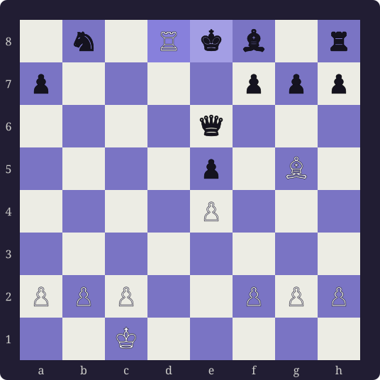
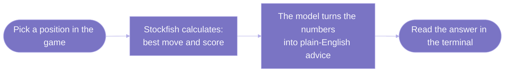

---
hide:
  - toc
icon: material/chess-king
---

# Dupont: Reviewing a Chess Game in Plain Language

**Dupont** is a local prototype — a personal tool, not a public product. At its core it is a **natural-language adapter for the Stockfish chess engine**: it reads a saved chess game and lets you ask about it in ordinary English, with every answer grounded in the engine's actual calculation. You point it at a PGN file (the standard text format a chess game is saved in), step through the moves, and ask questions like "why was that a mistake?" or "what was my opponent threatening?"

## Why This Exists

Uploading a PGN straight into a general chatbot like ChatGPT or Gemini and asking about the game has failed us in practice. The model loses track of where the pieces are, invents moves that were never played, and gives confident but wrong evaluations — it **hallucinates the game state**. A chess position is exactly the kind of precise, rule-bound thing a language model is bad at holding in its head.

Dupont fixes that by putting a real chess engine between you and the language model. The engine is the source of truth about the position; the language model never gets to decide what is on the board or which move is best.

## How The Two Pieces Split The Work

- A chess engine (**Stockfish**) does the exact calculation: which move is best, how good a position is, and what punishes a bad move. These scores and moves are computed entirely by the engine, in code — **no language model touches them** — so they come out the same way every time.
- A language model (run locally through **Ollama**) does only the *wording*: it turns the engine's numbers and move lists into readable advice. It is called only after the engine has done the calculation, and it is told to explain what the engine found and never to invent a move or a score of its own.

So the language model is a **translator for the engine, not a chess player**. If the engine says a move loses two points of material, the model explains *why* in words, but it does not get to disagree about the two points. That is the one thing a raw chatbot cannot promise.

A second engine is planned behind the same adapter: **Leela Chess Zero (Lc0)**, a neural engine that is strong at long-term positional judgement in quiet positions, where Stockfish's forcing-line search is less telling. It would add more engine facts for the language model to put into words — the adapter would simply be grounded in two engines instead of one. Lc0 is optional and is not in the current code; the tool runs fully on Stockfish alone today. For the full two-engine design and the hardware it targets, see the [Dual-Engine Design](./architecture/design.md).

<figure markdown>
  { width="420" }
  <figcaption>The finish of the included sample game — Morphy's 17. Rd8#. Dupont can walk you back through every move that led here.</figcaption>
</figure>

!!! note "Project status"
    Dupont is an early prototype for personal use. It runs locally on one machine, there is no hosted version, and the docs here are working notes rather than a public user guide.

    **✅ This is the v1 release.** Phase 0 (scaffolding) and Phase 1 (prototype testing, debugging, and the reworked interactive interface) are both complete; everything before v1 was v0. The [Status & Roadmap](./conclusions.md) page tracks every phase with status markers, and the planned second engine is on the [Dual-Engine Design](./architecture/design.md) page.

## What It Can Do Today

- Load a game from a PGN file, your clipboard, a pipe, or a paste — including a game copied straight from Chess.com — and step through it one key at a time (`f` forward, `b` back, or the arrow keys), or jump straight to a move number.
- See the engine's best move and score on every position, with the move named in plain language.
- Ask the engine to explain the score (`eval-score`), explain the top moves (`eval`, `eval-long`), or skip ahead to the next critical decision and explain it (`eval-critical`).
- Ask "why not this move?" for any legal move and get the engine's refutation, then a plain-language explanation of it.
- Ask free-form questions about the position and get an answer grounded in the engine's analysis.
- Start the local coach from inside the session with `serve`; without it, every engine feature still works and the coach prints engine facts.

## How The Pieces Fit Together

It is one simple pipeline, read left to right: the engine does the chess, then the model does the wording.

The engine always runs first and produces the facts. The coach only ever sees those facts plus your question, so its answer stays tied to what was actually calculated.

## Where To Read Next

| If you want to… | Read |
| :--- | :--- |
| Understand how the parts are wired together | [How It Works](./architecture.md) |
| See the planned two-engine design and target hardware | [Dual-Engine Design](./architecture/design.md) |
| Understand why the project is built this way | [Design Rationale](./design-rationale.md) |
| Set it up on your own machine | [Local Setup](./how-to-run.md) |
| Look up the commands and output format | [Commands Reference](./using-the-coach.md) |
| See the prototype status and what's planned | [Status & Roadmap](./conclusions.md) |
| Look up a term, chess or technical | [Glossary](./glossary.md) |
